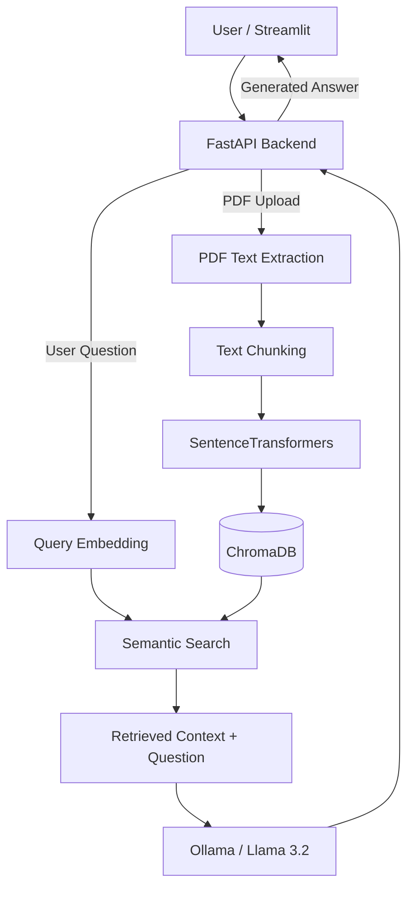

# Physics Research Assistant

**A local Retrieval-Augmented Generation (RAG) application for exploring scientific PDF documents using natural language.**

Physics Research Assistant enables users to upload scientific documents, index their content in a vector database, and ask questions grounded in the uploaded materials.

The application combines semantic search with a locally running Large Language Model (LLM), providing a practical example of an end-to-end AI application built with Python.

## Features

- **PDF ingestion:** Upload and extract text from PDF documents.
- **Text chunking:** Split extracted content into overlapping text fragments while preserving source metadata.
- **Semantic embeddings:** Convert text chunks into vector representations using SentenceTransformers.
- **Vector search:** Store and retrieve relevant document fragments with ChromaDB.
- **RAG question answering:** Generate context-aware answers using a locally hosted Llama 3.2 model.
- **Source references:** Include source references in generated answers.
- **Duplicate detection:** Identify previously uploaded PDFs using SHA-256 file hashes.
- **REST API:** Expose document upload, question answering, and health-check endpoints through FastAPI.
- **Web interface:** Interact with the application using Streamlit.
- **Docker support:** Run the application as a multi-container system.
- **Automated testing:** Validate core functionality with pytest and GitHub Actions.

## Architecture

The application follows a Retrieval-Augmented Generation architecture, separating document ingestion from question answering.



### Document ingestion

1. The user uploads a PDF through Streamlit or the FastAPI endpoint.
2. The backend validates the file and calculates its SHA-256 hash.
3. Text is extracted using PyMuPDF.
4. The extracted pages are divided into overlapping chunks.
5. SentenceTransformers generates vector embeddings.
6. The chunks, embeddings, and document metadata are stored in ChromaDB.

Each stored chunk includes information such as the document name, page number, chunk identifier, and document hash.

### Question answering

1. The user submits a natural-language question.
2. The question is converted into a vector embedding.
3. ChromaDB retrieves semantically relevant chunks.
4. Retrieved text is added to the LLM prompt as supporting context.
5. Llama 3.2 generates a response based on the retrieved material.
6. The answer is returned to the user through the web interface or API.

The current implementation uses vector similarity for retrieval and prompt instructions to encourage source-grounded responses.

## Technology Stack

| Component | Technology |
|---|---|
| Programming language | Python 3.12 |
| Backend API | FastAPI, Pydantic |
| Frontend | Streamlit |
| PDF processing | PyMuPDF |
| Embedding model | `paraphrase-multilingual-MiniLM-L12-v2` |
| Vector database | ChromaDB |
| Local LLM | Llama 3.2 |
| LLM serving | Ollama |
| Containerization | Docker, Docker Compose |
| Automated testing | pytest, unittest.mock |
| Continuous Integration | GitHub Actions |

## Project Structure

```text
physics-research-assistant/
├── src/
│   ├── api.py
│   ├── pdf_reader.py
│   ├── chunking.py
│   ├── embeddings.py
│   ├── vector_store.py
│   ├── database_search.py
│   └── rag_pipeline.py
├── frontend/
│   ├── app.py
│   ├── Dockerfile
│   └── requirements.txt
├── tests/
│   ├── test_api.py
│   ├── test_chunking.py
│   ├── test_vector_store.py
│   └── conftest.py
├── .github/
│   └── workflows/
│       └── tests.yml
├── Dockerfile
├── compose.yaml
├── requirements-backend.txt
├── requirements-dev.txt
└── README.md
```

Runtime data, vector database files, and downloaded model files are stored outside version control.

## Getting Started

### Prerequisites

- Docker Desktop or Docker Engine with Docker Compose
- Internet access for the initial image and model downloads
- Sufficient disk space and RAM for the embedding model and local LLM

The application is designed to run locally without requiring a paid external LLM API.

### 1. Clone the repository

```bash
git clone https://github.com/rlusio/physics-research-assistant.git
cd physics-research-assistant
```

### 2. Start the containers

```bash
docker compose up --build -d
```

Docker Compose starts the following services:

- `backend`: FastAPI server
- `frontend`: Streamlit interface
- `ollama`: Local LLM server

The initial build may take longer because Python dependencies and AI-related libraries must be downloaded.

### 3. Download the language model

```bash
docker compose exec ollama ollama pull llama3.2
```

Verify that the model is available:

```bash
docker compose exec ollama ollama list
```

Downloaded models are retained in a persistent Docker volume.

### 4. Open the application

Once the services have started, open:

**Streamlit interface:** http://localhost:8501

**FastAPI interactive documentation:** http://localhost:8000/docs

**Health check:** http://localhost:8000/health

### 5. Use the application

1. Open the Streamlit interface.
2. Upload a scientific PDF document.
3. Process the document to build its searchable index.
4. Enter a question related to the uploaded material.
5. Read the model's answer and any included source references.

Previously indexed documents are detected to avoid unnecessary repeat processing.

## REST API

The backend exposes three primary endpoints.

| Method | Endpoint | Description |
|---|---|---|
| `GET` | `/health` | Check API availability |
| `POST` | `/upload` | Upload and index a PDF |
| `POST` | `/ask` | Ask a question about indexed documents |

### Example: Ask a question

Request:

```http
POST /ask
Content-Type: application/json
```

```json
{
  "question": "What does the first law of thermodynamics state?"
}
```

Example response structure:

```json
{
  "answer": "The first law of thermodynamics expresses conservation of energy..."
}
```

The answer text varies with the documents retrieved and the language model's output.

### Example: Upload a PDF

```bash
curl -X POST http://localhost:8000/upload \
  -F "file=@physics.pdf"
```

A successful indexing request returns a document identifier, processing status, and the number of pages and chunks.

The upload endpoint accepts PDF files up to 10 MiB and performs basic file validation.

## Testing

The project includes automated unit and API tests implemented with pytest.

The current test suite covers:

- Short-text and long-text chunking
- Document existence checks
- Adding and deleting vector database records
- Invalid chunk and embedding counts
- FastAPI health checks
- Question validation and response handling
- Invalid file uploads and file size limits
- Duplicate detection
- Successful PDF processing
- Error handling and cleanup during PDF processing

### Run tests locally

Create a Python 3.12 environment and install dependencies:

```bash
python -m pip install -r requirements-backend.txt
python -m pip install -r requirements-dev.txt
```

Run:

```bash
python -m pytest -v tests/
```

The suite currently contains **17 automated tests**.

External operations are mocked where appropriate, so unit tests do not require generating LLM responses or modifying the document index.

### Continuous Integration

GitHub Actions runs the test suite automatically on pushes and pull requests.

The workflow installs Python dependencies and executes pytest in a clean Linux environment.

Workflow configuration: `.github/workflows/tests.yml`

## Design Decisions

### Local LLM inference

Ollama is used to serve Llama 3.2 locally. This avoids dependence on a paid, hosted LLM API and makes the project suitable for experimenting with local inference.

### Persistent vector storage

ChromaDB stores document chunks and embeddings between application runs, avoiding the need to re-index every document after restarting the application.

### Content-based document identification

SHA-256 hashes are calculated from uploaded PDF bytes. This allows the application to recognize identical documents even when their filenames differ.

### Modular architecture

Document parsing, chunking, embedding generation, vector storage, retrieval, and answer generation are separated into individual Python modules.

This makes the system easier to understand, test, and extend.

## Current Limitations

This project is an educational and portfolio-oriented prototype rather than a production-ready scientific research platform.

Known limitations include:

- **Scientific notation:** Text extraction from PDFs can distort equations, symbols, and complex layouts.
- **LLM reliability:** Generated answers may contain factual mistakes or misinterpret retrieved material.
- **Source attribution:** Model-generated source references are not a guarantee that every statement is supported by the cited passage.
- **Retrieval quality:** Semantic similarity does not always identify the most relevant scientific context.
- **Performance:** Local inference may be slow on CPU-only machines.
- **Security:** The application is intended for local use and does not currently include user authentication or multi-user access controls.
- **File validation:** Basic PDF validation does not replace comprehensive file security checks.

Answers should be verified against the original scientific sources, especially when equations, numerical results, or physical conventions are involved.

## Potential Improvements

Possible future extensions include:

- Displaying retrieved source passages directly in the web interface
- Adding retrieval quality evaluation and relevance thresholds
- Supporting mathematical expression extraction
- Improving metadata filtering and document management
- Adding configurable embedding and language models
- Implementing automated RAG evaluation
- Improving performance and scalability

## Project Motivation

Physics Research Assistant was developed as a practical software engineering and Generative AI project, combining experience with scientific materials and an interest in machine learning.

The goal was to understand and implement the complete RAG workflow — from PDF ingestion and vector search to LLM-based question answering — while gaining experience with backend development, testing, containerization, and continuous integration.

---

**Repository:** https://github.com/rlusio/physics-research-assistant

**Status:** Functional local prototype with automated tests and Docker-based deployment.
